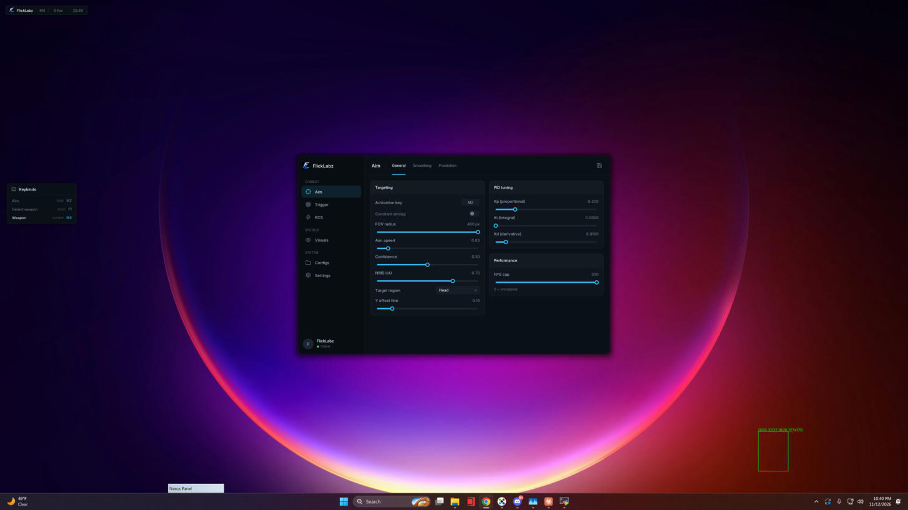
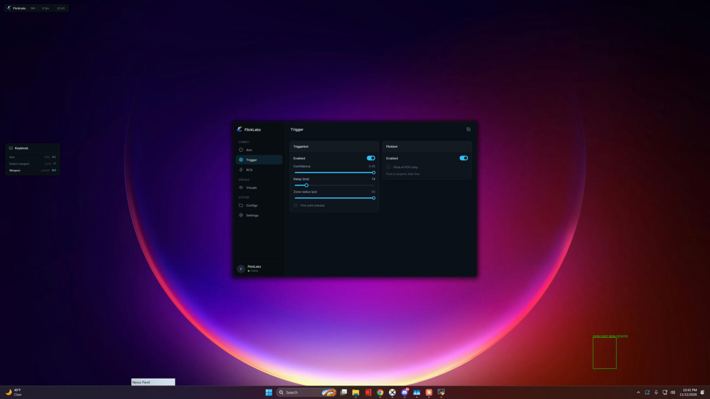
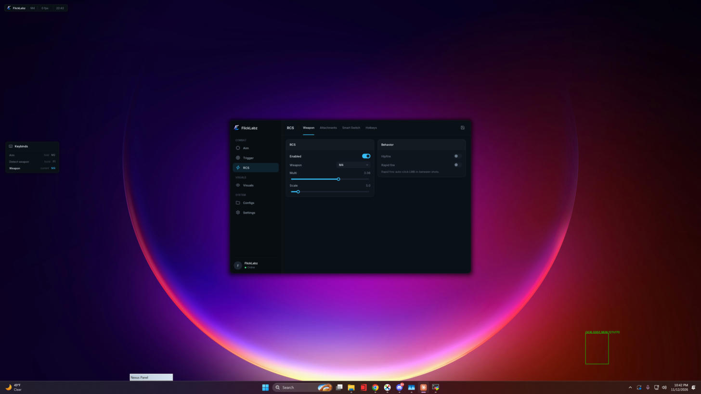
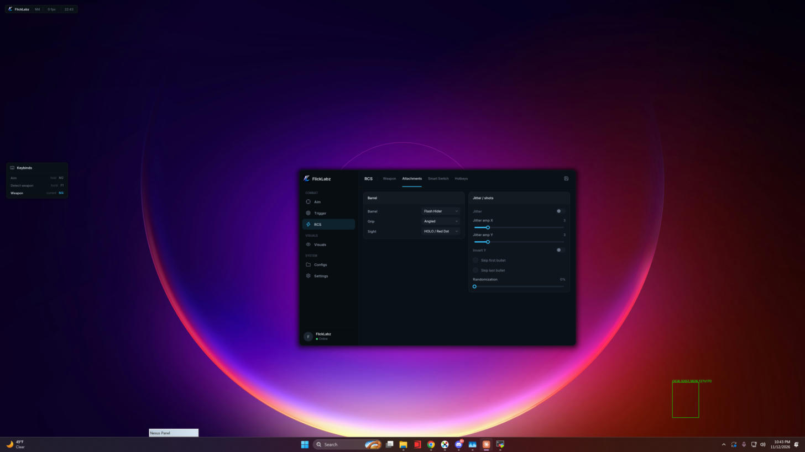
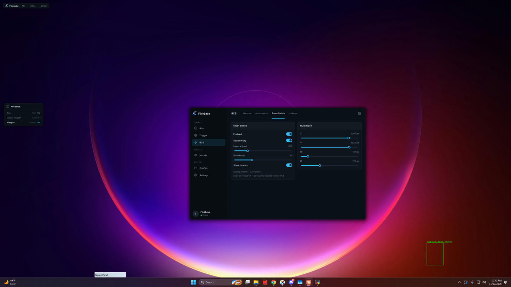
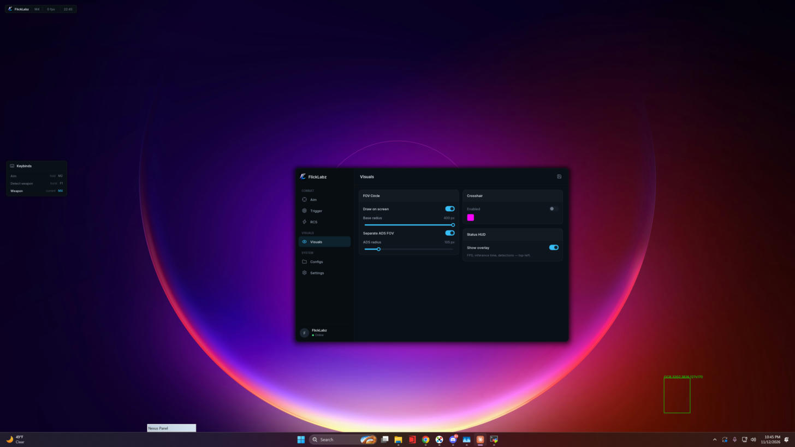
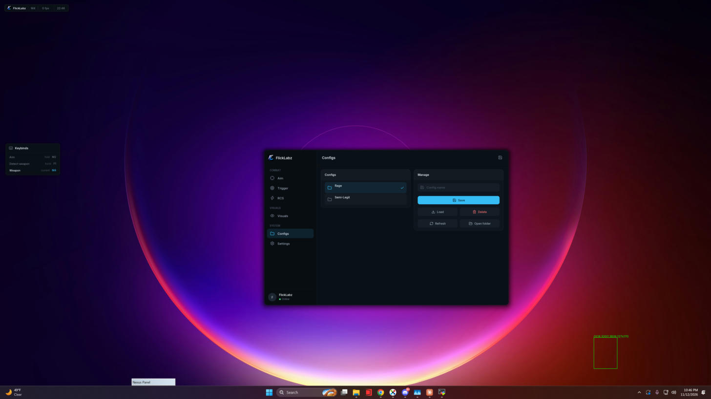
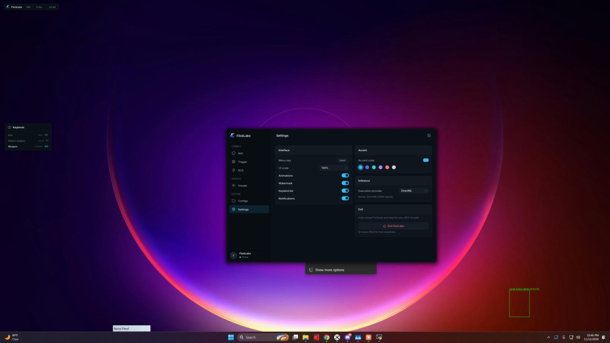

Full setup guide for the FlickLabz **R6 AI-Aim**. Pure AI-driven aim with recoil control, triggerbot and smart weapon detection. The AI-Aim is a fully **external** program — it does **not** inject into Rainbow Six Siege. It runs alongside the game as its own window, captures the screen with the GPU, runs on-device YOLO inference through DirectML, and drives the mouse through a signed kernel-level mouse driver. Follow each step in order.

## Pre-Setup Requirements

### GPU

The AI model runs through DirectML on your GPU. Any modern **DirectX 12 capable GPU** works (NVIDIA 10-series or newer, AMD RX 500 or newer, Intel Arc). Integrated graphics are supported but inference will be slower.

> First launch JIT-compiles DirectML shader kernels for the YOLO model, which can take **10–20 seconds** on cold runs. A centered "AI model loading..." banner stays on screen until the model is ready.

---

## Step by Step Guide

### Step 1: Download FlickLabz R6 AI-Aim

Download the latest `FlickLabz R6 AI-Aim.exe` from your dashboard.

### Step 2: Run as Administrator

Right-click `FlickLabz R6 AI-Aim.exe` → **Run as administrator**. Elevation is required so the kernel-level mouse driver can be installed and started.

### Step 3: Sign In

Enter your license credentials in the login window. The desktop app will show an 8-character pair code to confirm on the website. Discord and "Forgot Password" are also available there.

### Step 4: Wait for Driver + Model Load

On first launch the exe will:

1. Install and start the kernel-level mouse driver.
2. Fetch your encrypted AI model from the server.
3. Warm up the DirectML inference pipeline (20 iterations, ~10–20 seconds).

A centered banner at the top of the screen says **"AI model loading..."** with animated dots. Do **not** close the exe until it disappears — aim will not work until the model is ready.

### Step 5: Set Rainbow Six to Borderless

In Rainbow Six Siege → Options → Display Mode → **Borderless**. Exclusive Fullscreen is not supported by any external overlay.

### Step 6: Open the Menu

With both the AI-Aim and the game running, press **INS** to open the Glacier menu. The game pauses while the menu is open so your clicks do not fire or ADS.

> **Tip:** Press **INS** again to close the menu. The cursor centers on both open and close.

---

## Configuring the Menu

The menu has six tabs on the left rail — **Aim**, **Trigger**, **RCS**, **Visuals**, **Configs**, **Settings**. The top-left overlay always shows the active watermark (brand, weapon, FPS, clock) and your current keybinds.

### Aim

Everything the AI does when you hold your aim key.

- **Activation key** — the mouse button or key that activates aim (default **M2** / right mouse button).
- **Constant aiming** — if ON, aim is always engaged (no key required).
- **FOV radius** — size of the circle around your crosshair in which the AI will acquire a target. Shown in-game if the FOV overlay is enabled.
- **Aim speed** — how aggressively the pull toward the target is applied.
- **Confidence** — minimum detection confidence the AI must have before locking.
- **NMS IoU** — non-max suppression threshold. Leave default unless you know what you are doing.
- **Target region** — Head / Chest / Lower / Legs.
- **Y offset fine** — fine Y offset within the chosen target region.
- **PID tuning** (Kp / Ki / Kd) — proportional, integral and derivative gains for the aim smoothing loop.
- **FPS cap** — cap the inference loop (0 = uncapped).

### Trigger

Automatic fire + optional Flickbot.

- **Triggerbot → Enabled** — toggle the auto-fire.
- **Confidence** — minimum detection confidence that qualifies as "on target".
- **Delay (ms)** — delay before fire.
- **Zone radius (px)** — pixel radius around your crosshair that qualifies as "on target".
- **Fire until release** — keep firing while a target stays in the zone.
- **Flickbot → Enabled** — automatically flick to the target, then fire.
- **Flick in FOV only** — only flick to targets within your FOV radius.

> Triggerbot does **not** require a key — it fires automatically when a target enters the zone with the required confidence.

### RCS — Weapon

Recoil Control System main settings.

- **RCS → Enabled** — toggle recoil compensation.
- **Weapon** — manual weapon pick, or let **Smart Switch** auto-detect from the HUD.
- **Multi** — overall pattern multiplier per weapon.
- **Scale** — per-tick multiplier applied to each sub-move. Auto-set from your in-game INI.
- **Behavior → Hipfire** — apply RCS without ADS.
- **Behavior → Rapid fire** — auto-clicks LMB between shots.

### RCS — Attachments

Match the controls to the attachments you have equipped in-game.

- **Barrel** — None / Compensator / Flash Hider / Muzzle Brake.
- **Grip** — Angled / Vertical / Horizontal.
- **Sight** — HOLO/Red Dot (non-ACOG) / ACOG.
- **Jitter / shots** — amp X, amp Y, Invert Y, Skip first/last bullet, Randomization.

### RCS — Smart Switch (weapon auto-detect)

Lets the AI-Aim read your weapon icon from the HUD and switch the active RCS profile for you — no more manual swaps per weapon.

- **Enabled** — toggle the detector.
- **Scan on key** — only scan when you press the scan key (default **F1**), instead of continuous polling. Lighter on CPU and more deterministic.
- **Interval (ms)** — continuous poll rate (if Scan-on-key is OFF).
- **Scan burst** — frames to scan per key press (if Scan-on-key is ON).
- **Show overlay** — draw a green box over the HUD region the AI is reading from.
- **HUD region → X / Y / W / H** — pixel rectangle of the HUD area to sample. Pre-set per resolution; tweak only if the green box is not exactly over your weapon-switcher HUD.
- Status line at the bottom shows the gallery status and the last OCR result.

### Visuals

On-screen helpers.

- **FOV Circle → Draw on screen** — draws the FOV circle in-game.
- **Base radius** — radius when hip-firing.
- **Separate ADS FOV** — use a different radius while ADS.
- **ADS radius** — the FOV radius used when ADS is held.
- **Crosshair** — enable a custom crosshair + pick its color.
- **Status HUD → Show overlay** — compact top-left readout of FPS, inference time and detections.

### Configs

Save / load whole settings profiles.

- Left column — your saved configs with a checkmark on the active one.
- **Config name** — the name for a new save.
- **Save** — write the current settings to that name.
- **Load / Delete / Refresh / Open folder** — standard config management.

### Settings

Interface + inference backend.

- **Menu key** — the key that opens and closes the Glacier menu (default **Insert**).
- **UI scale** — overall menu scale.
- **Animations / Watermark / Keybind list / Notifications** — toggle the in-game overlays.
- **Accent color** — pick the menu accent color.
- **Execution provider** — which backend runs the AI model (default **DirectML**).
- **Exit FlickLabz** — graceful shutdown. You can also press **DELETE** anywhere.

---

## Hotkeys

| Key    | Action |
|--------|---------|
| **INS** | Toggle Glacier menu |
| **RMB** | Default aim key (configurable) |
| **F1**  | Trigger Smart Switch scan burst |
| **F8**  | Dump current AI input to `ai_sees.bmp` |
| **F9** | Cursor / foreground diagnostic (written to log) |
| **DEL** | Panic exit — instantly closes the software |

---

## Panic Exit

Press **Delete** at any time to immediately close the software. A dedicated watchdog thread responds instantly even during the model load.

---

## Troubleshooting

<Accordion title="Aim does not work this launch (but RCS does)">
  The AI model warmup failed on this run (DirectML JIT race). The exe retries the warmup automatically — if it still fails, close and relaunch. The top-of-screen banner stays up until the model is ready.
</Accordion>

<Accordion title="Mouse cursor keeps showing in gameplay">
  Make sure Rainbow Six is set to **Borderless**, not Fullscreen. If the cursor still shows after alt-tab, close the menu once by pressing INS twice — the exe sends R6 a focus-return sequence that re-engages its cursor lock.
</Accordion>

<Accordion title="Game shoots or ADS right after closing the menu">
  Release your mouse buttons **before** pressing INS to close the menu. The exe defers the focus-return to R6 until mouse buttons are physically released to prevent this.
</Accordion>

<Accordion title="Driver Initialization Failed">
  Relaunch — the exe auto-cycles the mouse-driver service to clear a stale channel. If it still fails, restart Windows.
</Accordion>

<Accordion title="After a long time since last open, PC restart required">
  The driver channel can go stale between runs. The exe auto-recovers without a reboot — just launch it again.
</Accordion>

<Accordion title="Triggerbot will not fire">
  Open the Trigger tab and lower the **Confidence** threshold (0.30 works for the current model). Confirm the **Zone radius** is big enough (default 15 px). Triggerbot is independent of the aim key — it fires automatically when a target enters the zone with sufficient confidence.
</Accordion>

<Accordion title="Cannot Connect to Server">
  Use a VPN such as [WARP](https://one.one.one.one/) and retry launching.
</Accordion>
