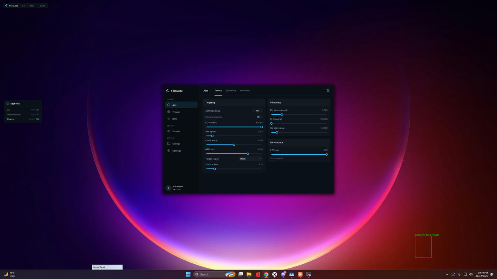
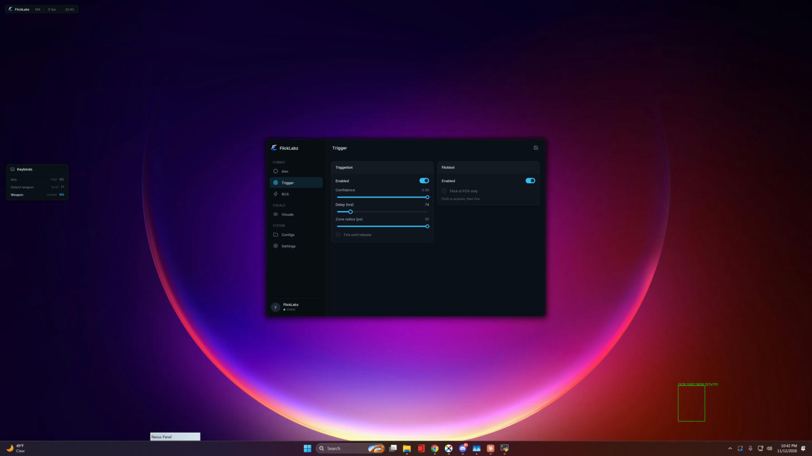
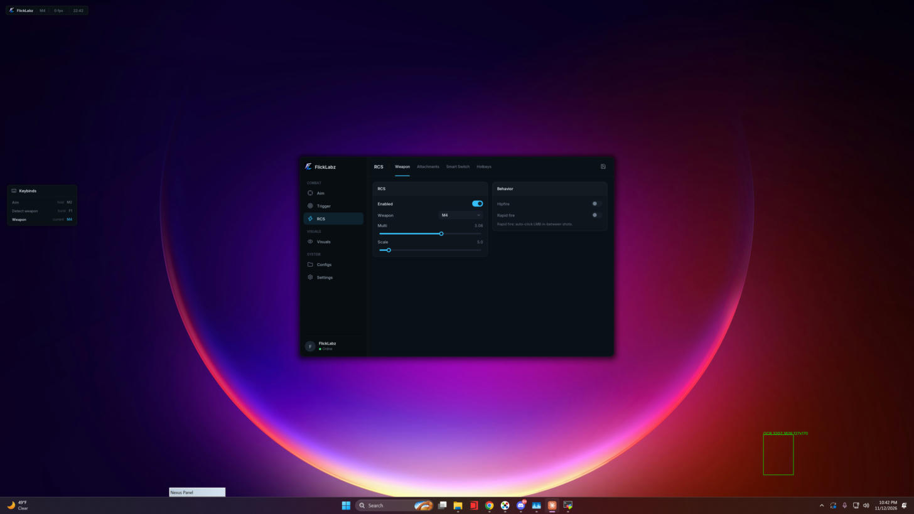
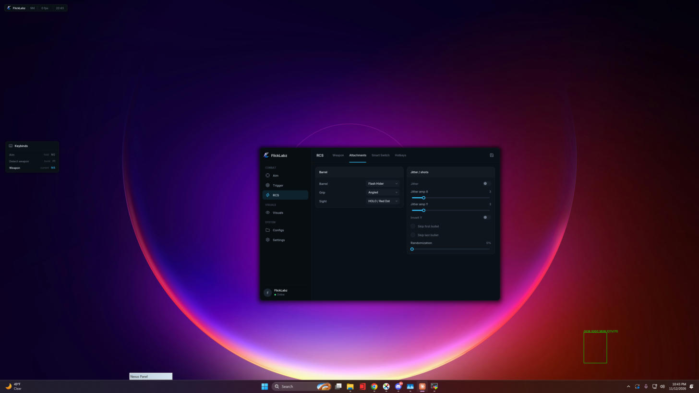
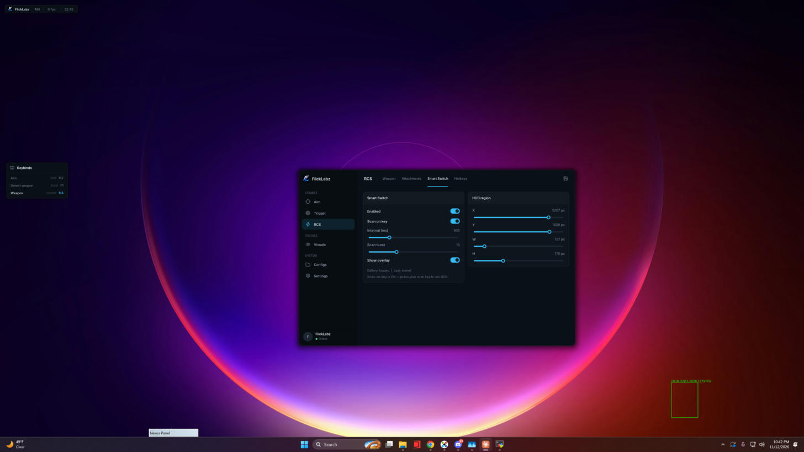
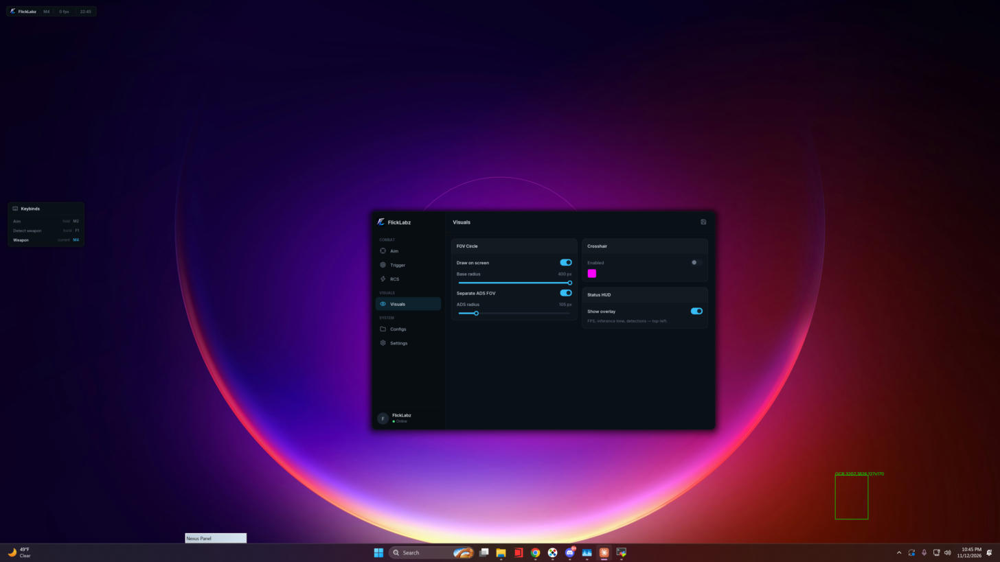
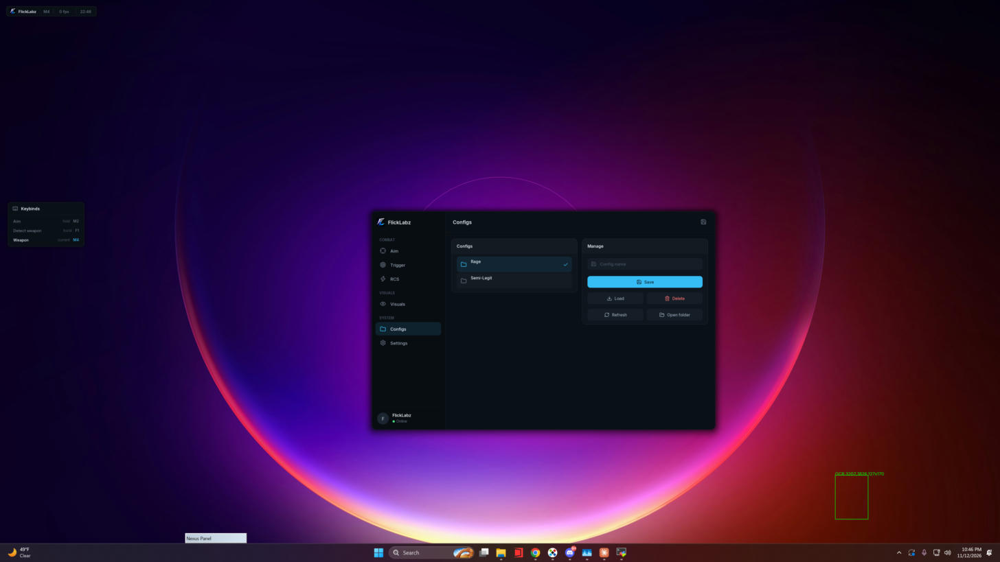
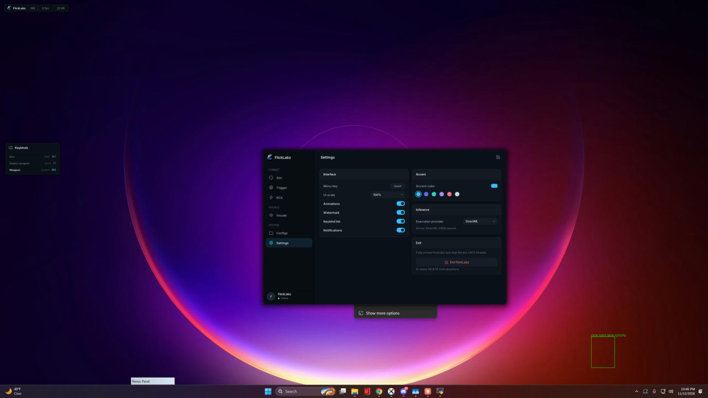

Full setup guide for the FlickLabz R6 **AIO** (all-in-one) package. The AIO is a fully **external** program — it does **not** inject into Rainbow Six Siege. It runs alongside the game as its own window and uses a signed kernel-level mouse driver (ZDrv) for mouse movement. Follow each step in order.

## Pre-Setup Instructions

### C++ Runtime Components

The software uses C++ and DirectX 11 to render its overlay window. Install the Microsoft C++ Runtime Components:

> This is a standard Microsoft component used by many applications. Installing it ensures everything runs smoothly.

**Install both:**

- [vc_redist.x86](https://aka.ms/vs/17/release/vc_redist.x86.exe)
- [vc_redist.x64](https://aka.ms/vs/17/release/vc_redist.x64.exe)

---

### Enemy Color (REQUIRED for aim)

The AIO Aim acquires targets by their outline color. **Enemy outlines must be set to RED** inside Rainbow Six Siege's accessibility settings — if they are not, Aim will not detect enemies at all.

**How to set it:**

1. Launch Rainbow Six Siege.
2. Open **Options** → **Accessibility**.
3. Set **Color Blind** / **Color Vision** to a preset that renders enemy outlines **red** (any preset that keeps enemy highlights red is fine — the default red/tritanopia with enemies=red works).
4. Confirm in-game that enemies have a red outline when highlighted.

> If enemies are blue, yellow, green or any other color, the Aim cannot see them. This is the single most common "aim doesn't work" cause.

---

### Windows Defender

Because the software installs a kernel-level mouse driver, Windows Defender may flag the launcher. Temporarily disable Defender before first launch.

**Recommended tool:** [Defender Control v2.1](https://www.sordum.org/9480/defender-control-v2-1/) — toggle Defender on and off with one click.

---

### Anti-Cheats

Some anti-cheats keep running in the background even when their game is closed and can block the software from launching.

**Anti-Cheats to uninstall:**

- FACEIT
- Riot Vanguard

---

> **WARNING:** Complete all requirements above (including enemy color = red) before launching.

## Step by Step Guide

### Step 1: Download the AIO

Download the latest FlickLabz R6 AIO from your dashboard.

### Step 2: Run as Administrator

Right-click `FlickLabz R6 AIO.exe` → **Run as administrator**. Elevation is required so the ZDrv kernel driver can be installed and started.

### Step 3: Sign In

Enter your license credentials in the login window.

### Step 4: Set Rainbow Six to Borderless

In Rainbow Six Siege → Options → Display Mode → **Borderless**. Exclusive Fullscreen is not supported (no external overlay can draw over exclusive fullscreen).

### Step 5: Confirm Enemy Color = Red

Reconfirm in **Options → Accessibility** that enemy outlines are **red**. The AIO Aim will not detect enemies otherwise.

### Step 6: Open the Menu

With both the AIO and the game running, press **INS** to open the in-game menu. The game pauses while the menu is open so your clicks do not fire or ADS.

> **Tip:** Press **INS** again to close the menu. If your keyboard has no INS key, remap the menu key in **Settings** or use the Windows on-screen keyboard.

---

## Configuring the Menu

The AIO menu has six tabs on the left rail — **Aim**, **Trigger**, **RCS**, **Visuals**, **Configs**, **Settings**. Clicking a tab opens its panel to the right. The watermark in the top-left always shows the brand, current weapon, FPS and clock; the keybind box right below shows your live binds.

### Aim

- **Activation key** — the mouse button or key that activates aim (default **M2** / right mouse button).
- **Constant aiming** — if ON, aim is always engaged (no key required).
- **FOV radius** — size of the circle around your crosshair in which targets are acquired.
- **Aim speed** — how aggressively the pull toward the target is applied.
- **Confidence** — minimum detection confidence the AI must have before locking.
- **NMS IoU** — non-max suppression threshold. Leave default unless you know what you are doing.
- **Target region** — Head / Chest / Lower / Legs.
- **Y offset fine** — fine Y offset within the chosen target region.
- **PID tuning** (Kp / Ki / Kd) — gains for the aim smoothing loop.
- **FPS cap** — cap the inference loop (0 = uncapped).

### Trigger

- **Triggerbot → Enabled** — toggle auto-fire.
- **Confidence** — minimum detection confidence that qualifies as "on target".
- **Delay (ms)** — delay before fire.
- **Zone radius (px)** — pixel radius around your crosshair that qualifies as "on target".
- **Fire until release** — keep firing while a target stays in the zone.
- **Flickbot → Enabled** — automatically flick to the target, then fire.
- **Flick in FOV only** — only flick to targets within your FOV radius.

> Triggerbot does **not** require a key — it fires automatically.

### RCS — Weapon

- **RCS → Enabled** — toggle recoil compensation.
- **Weapon** — manually pick, or let **Smart Switch** auto-detect from the HUD.
- **Multi** — overall pattern multiplier per weapon.
- **Scale** — per-tick multiplier applied to each sub-move. Auto-set from your in-game INI.
- **Behavior → Hipfire** — apply RCS without ADS.
- **Behavior → Rapid fire** — auto-clicks LMB between shots.

### RCS — Attachments

Match these to the attachments on your equipped weapon.

- **Barrel** — None / Compensator / Flash Hider / Muzzle Brake.
- **Grip** — Angled / Vertical / Horizontal.
- **Sight** — HOLO/Red Dot (non-ACOG) / ACOG.
- **Jitter / shots** — amp X, amp Y, Invert Y, Skip first/last bullet, Randomization.

### RCS — Smart Switch (weapon auto-detect)

Lets the AIO read your weapon icon from the HUD and switch the active RCS profile for you — no more manual swaps.

- **Enabled** — toggle the detector.
- **Scan on key** — only scan when you press the scan key (default **F1**), instead of continuous polling. Lighter on CPU and more deterministic.
- **Interval (ms)** — continuous poll rate (if Scan-on-key is OFF).
- **Scan burst** — frames to scan per key press (if Scan-on-key is ON).
- **Show overlay** — draw a green box over the HUD region being read.
- **HUD region → X / Y / W / H** — pixel rectangle of the HUD area to sample. Pre-set per resolution; tweak only if the green box is not exactly over your weapon-switcher HUD.
- Status line at the bottom shows gallery status and the last OCR result.

### Visuals

- **FOV Circle → Draw on screen** — draws the FOV circle in-game.
- **Base radius** — radius when hip-firing.
- **Separate ADS FOV** — use a different radius while ADS.
- **ADS radius** — the FOV radius used when ADS is held.
- **Crosshair** — enable a custom crosshair + pick its color.
- **Status HUD → Show overlay** — compact top-left readout of FPS, inference time and detections.

### Configs

- Left column — your saved configs with a checkmark on the active one.
- **Config name** — the name for a new save.
- **Save** — write the current settings to that name.
- **Load / Delete / Refresh / Open folder** — standard config management.

### Settings

- **Menu key** — the key that opens and closes the menu (default **Insert**).
- **UI scale** — overall menu scale.
- **Animations / Watermark / Keybind list / Notifications** — toggle the in-game overlays.
- **Accent color** — pick the menu accent color.
- **Execution provider** — which backend runs any AI model (default **DirectML**).
- **Exit FlickLabz** — graceful shutdown. You can also press **DELETE** anywhere.

---

## Panic Exit

Press **Delete** at any time to immediately close the software and all its features. The watchdog responds instantly even during startup.

---

## Troubleshooting

<Accordion title="Aim does nothing when I hold the aim key">
  99% of the time this is the **enemy outline color**. Open R6 → Options → Accessibility → set a Color Blind / Color Vision preset that renders enemies **red**. Confirm in-game that enemy outlines are red. The AIO Aim will not detect enemies of any other color.
</Accordion>

<Accordion title="Driver Initialization Failed">
  Repeat the Windows Defender step from the pre-setup requirements and launch again. The software auto-recovers a stale driver without a reboot on most startups.
</Accordion>

<Accordion title="Cannot Connect to Server">
  Use a VPN such as [WARP](https://one.one.one.one/) and retry launching.
</Accordion>

<Accordion title="After a long time since last open, it will not launch">
  The ZDrv kernel channel can go stale while the service still reports running. Launch the exe again — it auto-recovers by cycling the service without a reboot. If it still fails, restart Windows.
</Accordion>

<Accordion title="Menu opens but clicks hit the game">
  Make sure Rainbow Six is set to **Borderless**, not Fullscreen. External overlays cannot work over exclusive-fullscreen games.
</Accordion>
